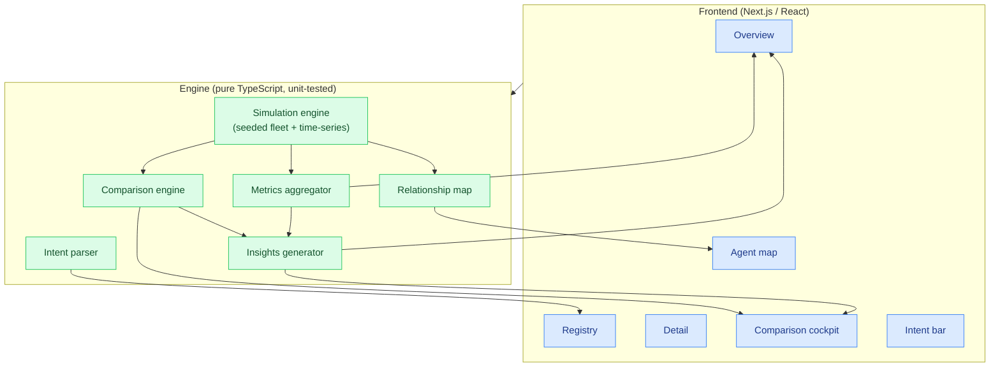
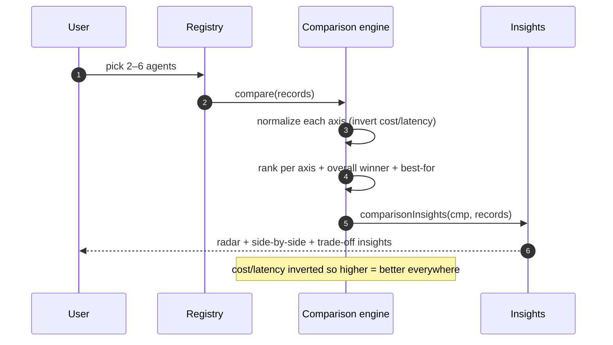

# AgentForge Dashboard

**▶ Live demo: https://parag-labs.github.io/agentforge-dashboard/** — runs entirely in your
browser on a deterministic simulation engine (no backend, no API keys). Clone-to-demo in one
command.

A modern dashboard to **register, monitor, and deeply compare your AI agents** in one place.
Where enterprise control planes focus on governance for IT admins, AgentForge is built for the
person who *owns* the agents: a beautiful, spatial, intent-first canvas with a first-class
**comparison cockpit** at its heart.

It ships with a rich **simulation engine** that generates a realistic, living fleet — so the
dashboard looks alive and is fully demoable without a single real LLM call.

---

## What it does

- **Overview canvas** — hero metrics (agents, active today, success, latency, weekly cost,
  fleet health), a live activity feed, and grounded generative insight cards.
- **Registry** — a searchable, filterable grid of agents with status badges and quick actions.
- **Agent detail** — per-agent time-series (success / latency / cost), quality & trust scores,
  capabilities, tools, and cost breakdown.
- **Comparison cockpit** (the differentiator) — select 2–6 agents and see a multi-axis radar,
  a normalized side-by-side table with per-axis winners, and generative trade-off insights.
- **Agent map** — a relationship graph where agents are linked by the tools they share.
- **Intent bar** — type *"show expensive agents"* or *"which agents need attention?"* and the
  view filters/sorts itself.

## Why it's interesting

The engineering lives in `src/engine` — a pure-TypeScript core with **no React imports**, fully
unit-tested and deterministic:

- A **seeded simulation engine** produces a diverse fleet with correlated metrics and 24-hour
  time-series. Same seed → same fleet, every run, so the demo and the tests are reproducible.
- A **comparison engine** normalizes six axes (inverting cost/latency so "higher = better"),
  ranks each agent per axis, and computes an overall winner and "best for X" recommendations.
- A **generative insights** layer produces natural-language observations *grounded in real
  computed numbers* — e.g. *"CodeReviewer is 5.3× the fleet's median weekly cost"* — so the
  panel never fabricates a figure.
- A **rule-based intent parser** turns free text into a structured filter/sort/compare query.

## Screenshots

The Overview (glass hero metrics + insights + activity), the Comparison Cockpit (radar +
side-by-side + trade-offs), and the Agent Map (React Flow). Run `pnpm dev` to see them live.

## Architecture



The UI is a thin shell; every number and insight comes from the deterministic engine. The
architecture keeps a clean seam so the simulation can later be swapped for real agent telemetry
behind the same types.

## Comparison flow



## Metrics surfaced

Health & reliability (status, uptime, success rate, error rate), performance (avg/p95 latency,
tokens per run, runs/hour), cost (cost per run, weekly cost, efficiency), and quality & trust
(quality score, trust score) — exactly the axes the design calls for. The comparison view adds
per-axis ranking, a trade-off summary, and "best for X" recommendations.

## Design

Dark-first with **soft glassmorphism** (backdrop-blur panels, subtle borders), **layered depth**
(multiple shadow levels, cards that lift on hover), and **calm accents** (one violet primary +
a cyan secondary, plus semantic success/warn/error). Charts are hand-rolled inline SVG
(sparklines + a multi-series radar) so there's no chart dependency and everything stays crisp.

## Evaluation

Produced by `pnpm eval` from real runs — never hand-written. The correctness metric is
**invalid (ungrounded) insights**: insights that reference a figure not in the data. Always 0.

| Metric | Value |
|--------|-------|
| Agents simulated | 10 |
| Activity events | 14 |
| Avg success rate | 89% |
| Fleet health score | 89.1/100 |
| Comparison winner (top 4) | FinanceAgent |
| Fleet insights | 4 |
| Comparison insights | 7 |
| **Invalid (ungrounded) insights** | **0** |
| Agent-map edges | 4 |
| Simulation reproducible | yes |
| Intent reproducible | yes |

## Local setup

Requirements: Node 26+, pnpm 12+. No API keys, no database.

```bash
pnpm install
pnpm dev          # http://localhost:3000
pnpm test         # engine tests (Vitest)
pnpm typecheck
pnpm lint
pnpm eval         # print the eval table above
pnpm build
```

## Docker

```bash
docker compose up --build   # http://localhost:3000
```

Builds and serves the app in production mode. No secrets.

## Testing

The pure-TS engine is covered by Vitest — 31 tests:

- **Simulation** — determinism, diverse agents, metric ranges, time-series shape.
- **Aggregator** — hero metrics in range, health score, attention flags, empty-fleet handling.
- **Comparison** — 2–6 bounds, axis normalization & inversion, cheapest wins cost, determinism.
- **Intent** — expensive/healthy/attention/keyword parsing and application, sort ordering.
- **Insights** — every insight is grounded (names a real agent or a real figure); determinism.
- **Map + evaluation** — shared-tool edges, and the end-to-end deterministic-checks harness.

```bash
pnpm test
```

## Roadmap

- Connect to real agent telemetry behind the existing engine types (the seam is already there).
- Persist comparison sessions and shareable comparison links.
- A command palette and keyboard-first navigation.
- Time-range controls and overlayable multi-agent time-series in the cockpit.
- Export a comparison to PDF/markdown.

## Layout

```
agentforge-dashboard/
├── src/
│   ├── engine/                 # deterministic core (framework-free, unit-tested)
│   │   ├── rng.ts              # seeded PRNG + helpers
│   │   ├── types.ts            # Agent / AgentMetrics / series / activity types
│   │   ├── simulation.ts       # seeded fleet + time-series + activity feed
│   │   ├── aggregate.ts        # fleet/hero metrics + health score
│   │   ├── compare.ts          # comparison engine (axes, ranks, winner, best-for)
│   │   ├── insights.ts         # grounded natural-language insights
│   │   ├── intent.ts           # rule-based intent parser + apply
│   │   ├── map.ts              # shared-tool relationship map
│   │   ├── evaluate.ts         # deterministic-checks harness
│   │   ├── eval-cli.ts         # `pnpm eval`
│   │   └── __tests__/          # 31 Vitest tests
│   ├── app/                    # Next.js app router (client-side dashboard)
│   └── components/             # Dashboard, charts (SVG), React Flow agent map
├── ARCHITECTURE.md
├── SECURITY.md
├── CONTRIBUTING.md
├── CHANGELOG.md
├── Dockerfile
└── docker-compose.yml
```

## License

MIT — see [LICENSE](LICENSE).
